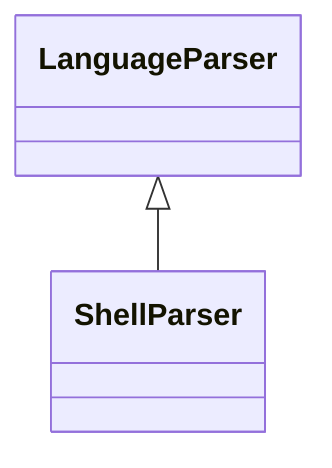

# `readmenator.parsers._shell`

> Source: [readmenator/parsers/_shell.py:1](../../readmenator/parsers/_shell.py#L1) | language `py` | coverage 100.0% | [API index](../index.md)

Shell parser: regex extraction of symbols, signatures, docstrings, and imports.

## Contents

- **Classes:** [`ShellParser`](#shellparser)

## Type Diagram



## Classes

<a id="shellparser"></a>

### `ShellParser`

`class` | [readmenator/parsers/_shell.py:11](../../readmenator/parsers/_shell.py#L11)

```python
class ShellParser(LanguageParser)
```

Bases: [`LanguageParser`](readmenator.parsers._base.py.md#languageparser)

Parser for shell scripts (.sh, .bash, .zsh).

Extracts function declarations in both POSIX (``name() {``)
and `[`function`](readmenator._models.py.md#dataflowissue-function)` keyword syntax.

---
