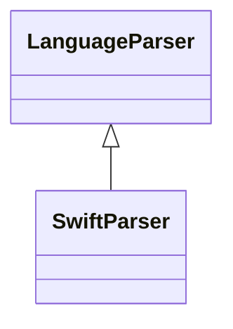

# `readmenator.parsers._swift`

> Source: [readmenator/parsers/_swift.py:1](../../readmenator/parsers/_swift.py#L1) | language `py` | coverage 100.0% | [API index](../index.md)

Swift parser: regex extraction of symbols, signatures, docstrings, and imports.

## Contents

- **Classes:** [`SwiftParser`](#swiftparser)

## Type Diagram



## Classes

<a id="swiftparser"></a>

### `SwiftParser`

`class` | [readmenator/parsers/_swift.py:11](../../readmenator/parsers/_swift.py#L11)

```python
class SwiftParser(LanguageParser)
```

Bases: [`LanguageParser`](readmenator.parsers._base.py.md#languageparser)

Parser for Swift (.swift).

Extracts ``import`` statements, class/struct/enum/protocol
declarations with inheritance, and function definitions.

---
