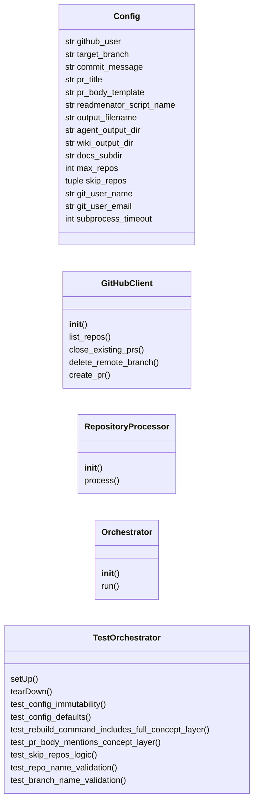
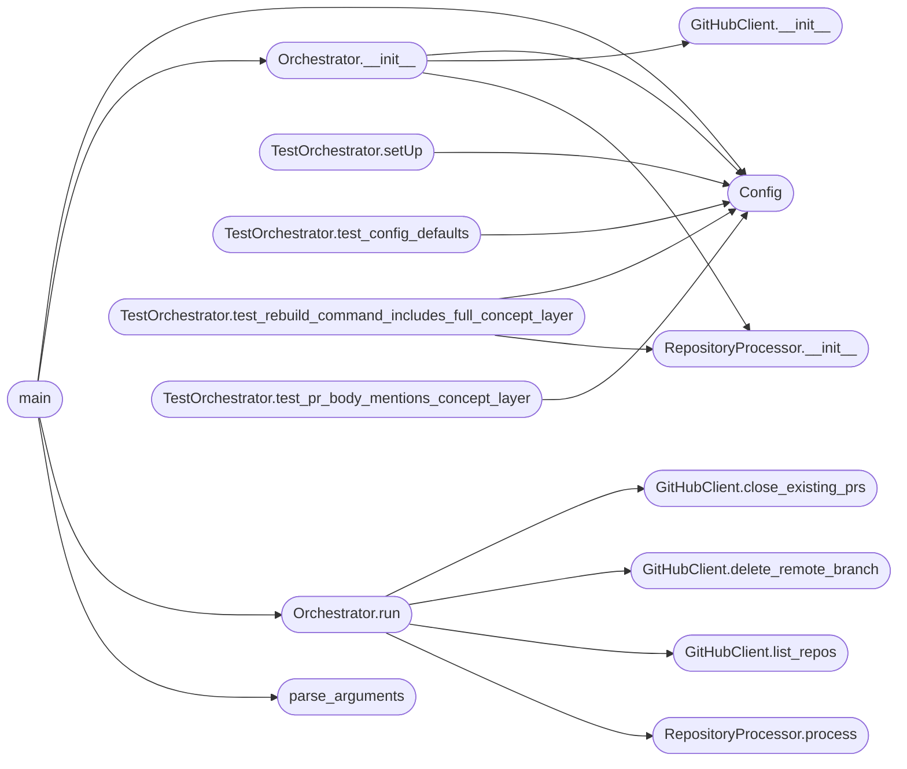

# `readmenator_orchestrator`

> Source: [readmenator_orchestrator.py:1](../../readmenator_orchestrator.py#L1) | language `py` | coverage 3.8% | [API index](../index.md)

## Contents

- **Classes:** [`Config`](#config), [`GitHubClient`](#githubclient), [`RepositoryProcessor`](#repositoryprocessor), [`Orchestrator`](#orchestrator), [`TestOrchestrator`](#testorchestrator)
- **Functions:** [`parse_arguments`](#parse_arguments), [`main`](#main)

## Type Diagram



## Call Graph

Solid arrows stay in this module, dashed arrows leave it.



## Classes

<a id="config"></a>

### `Config`

`class` `dataclass` | [readmenator_orchestrator.py:21](../../readmenator_orchestrator.py#L21)

Decorators: `@dataclass(frozen=True)`

```python
class Config
```

**Attributes**

| Name | Type | Default | Description |
|---|---|---|---|
| [`github_user`](#config-github_user) | `str` | `''` |  |
| [`target_branch`](#config-target_branch) | `str` | `'docs-export'` |  |
| [`commit_message`](#config-commit_message) | `str` | `'docs: auto-generate knowledge base with readmenator'` |  |
| [`pr_title`](#config-pr_title) | `str` | `'Documentation Export: Auto-generated Knowledge Base'` |  |
| [`pr_body_template`](#config-pr_body_template) | `str` | `` 'Automated documentation export generated on {timestamp}.\n\nThis PR adds `KNOWLEDGE_BASE.md` and `readmenator-agent/` to the root, plus `docs/KNOWLEDGE_BASE.md`.\n\nThe `readmenator-agent/` directory contains grep-friendly files for AI agents:\n- `INDEX.md` -- file -> purpose map\n- `API.md` -- public function contracts\n- `GOTCHAS.md` -- change warnings\n- `CONCEPTS.md` -- semantic noun/verb layer plus dialectic prompts\n- `KB_<subsystem>.md` -- per-subsystem context\n\nThe `readmenator-wiki/` directory contains the progressive wiki:\n- `index.md` -- entry point\n- `concepts.md` + `concept_graph.json` -- ConceptGraph second brain\n- `community_*.md` -- per-community synthesis\n\nEach run replaces this branch (and closes any previous PR using the same head), so only the latest snapshot is open at any time.\n\nGenerated by `readmenator_orchestrator.py` with `--rebuild` (full ConceptGraph).' `` |  |
| [`readmenator_script_name`](#config-readmenator_script_name) | `str` | `'readmenator.py'` |  |
| [`output_filename`](#config-output_filename) | `str` | `'KNOWLEDGE_BASE.md'` |  |
| [`agent_output_dir`](#config-agent_output_dir) | `str` | `'readmenator-agent'` |  |
| [`wiki_output_dir`](#config-wiki_output_dir) | `str` | `'readmenator-wiki'` |  |
| [`docs_subdir`](#config-docs_subdir) | `str` | `'docs'` |  |
| [`max_repos`](#config-max_repos) | `int` | `1000` |  |
| [`skip_repos`](#config-skip_repos) | `tuple` | `('ReadMenator', 'security_issue')` |  |
| [`git_user_name`](#config-git_user_name) | `str` | `'readmenator-bot'` |  |
| [`git_user_email`](#config-git_user_email) | `str` | `'readmenator-bot@users.noreply.github.com'` |  |
| [`subprocess_timeout`](#config-subprocess_timeout) | `int` | `300` |  |

---

<a id="githubclient"></a>

### `GitHubClient`

`class` | [readmenator_orchestrator.py:83](../../readmenator_orchestrator.py#L83)

```python
class GitHubClient
```

**Members**

| Member | Kind | Summary |
|---|---|---|
| [`__init__`](#githubclient-__init__) | constructor |  |
| [`list_repos`](#githubclient-list_repos) | method |  |
| [`close_existing_prs`](#githubclient-close_existing_prs) | method |  |
| [`delete_remote_branch`](#githubclient-delete_remote_branch) | method |  |
| [`create_pr`](#githubclient-create_pr) | method |  |

<a id="githubclient-__init__"></a>

#### `GitHubClient.__init__`

`constructor` | [readmenator_orchestrator.py:84](../../readmenator_orchestrator.py#L84)

```python
def __init__(self, config: Config) -> None
```

**Parameters**

| Name | Type | Default | Description |
|---|---|---|---|
| `config` | `Config` |  |  |

*Called by:* [`Orchestrator.__init__`](#orchestrator-__init__)

<a id="githubclient-list_repos"></a>

#### `GitHubClient.list_repos`

`method` | [readmenator_orchestrator.py:124](../../readmenator_orchestrator.py#L124)

```python
def list_repos(self) -> List[str]
```

**Returns:** `List[str]`

*Called by:* [`Orchestrator.run`](#orchestrator-run)

<a id="githubclient-close_existing_prs"></a>

#### `GitHubClient.close_existing_prs`

`method` | [readmenator_orchestrator.py:136](../../readmenator_orchestrator.py#L136)

```python
def close_existing_prs(self, repo: str) -> None
```

**Parameters**

| Name | Type | Default | Description |
|---|---|---|---|
| `repo` | `str` |  |  |

*Called by:* [`Orchestrator.run`](#orchestrator-run)

<a id="githubclient-delete_remote_branch"></a>

#### `GitHubClient.delete_remote_branch`

`method` | [readmenator_orchestrator.py:164](../../readmenator_orchestrator.py#L164)

```python
def delete_remote_branch(self, repo: str) -> None
```

**Parameters**

| Name | Type | Default | Description |
|---|---|---|---|
| `repo` | `str` |  |  |

*Called by:* [`Orchestrator.run`](#orchestrator-run)

<a id="githubclient-create_pr"></a>

#### `GitHubClient.create_pr`

`method` | [readmenator_orchestrator.py:176](../../readmenator_orchestrator.py#L176)

```python
def create_pr(self, repo: str, default_branch: str, timestamp: str) -> str
```

**Parameters**

| Name | Type | Default | Description |
|---|---|---|---|
| `repo` | `str` |  |  |
| `default_branch` | `str` |  |  |
| `timestamp` | `str` |  |  |

**Returns:** `str`

---

<a id="repositoryprocessor"></a>

### `RepositoryProcessor`

`class` | [readmenator_orchestrator.py:197](../../readmenator_orchestrator.py#L197)

```python
class RepositoryProcessor
```

**Members**

| Member | Kind | Summary |
|---|---|---|
| [`__init__`](#repositoryprocessor-__init__) | constructor |  |
| [`process`](#repositoryprocessor-process) | method |  |

<a id="repositoryprocessor-__init__"></a>

#### `RepositoryProcessor.__init__`

`constructor` | [readmenator_orchestrator.py:198](../../readmenator_orchestrator.py#L198)

```python
def __init__(self, config: Config, github_client: GitHubClient) -> None
```

**Parameters**

| Name | Type | Default | Description |
|---|---|---|---|
| `config` | `Config` |  |  |
| `github_client` | `GitHubClient` |  |  |

*Called by:* [`Orchestrator.__init__`](#orchestrator-__init__), [`TestOrchestrator.test_rebuild_command_includes_full_concept_layer`](#testorchestrator-test_rebuild_command_includes_full_concept_layer)

<a id="repositoryprocessor-process"></a>

#### `RepositoryProcessor.process`

`method` | [readmenator_orchestrator.py:202](../../readmenator_orchestrator.py#L202)

```python
def process(self, repo: str) -> tuple
```

**Parameters**

| Name | Type | Default | Description |
|---|---|---|---|
| `repo` | `str` |  |  |

**Returns:** `tuple`

*Called by:* [`Orchestrator.run`](#orchestrator-run)

---

<a id="orchestrator"></a>

### `Orchestrator`

`class` | [readmenator_orchestrator.py:366](../../readmenator_orchestrator.py#L366)

```python
class Orchestrator
```

**Members**

| Member | Kind | Summary |
|---|---|---|
| [`__init__`](#orchestrator-__init__) | constructor |  |
| [`run`](#orchestrator-run) | method |  |

<a id="orchestrator-__init__"></a>

#### `Orchestrator.__init__`

`constructor` | [readmenator_orchestrator.py:367](../../readmenator_orchestrator.py#L367)

```python
def __init__(self, config: Optional[Config] = None) -> None
```

**Parameters**

| Name | Type | Default | Description |
|---|---|---|---|
| `config` | `Optional[Config]` | `None` |  |

*Calls:* [`Config`](#config), [`GitHubClient.__init__`](#githubclient-__init__), [`RepositoryProcessor.__init__`](#repositoryprocessor-__init__)

*Called by:* [`main`](#main)

<a id="orchestrator-run"></a>

#### `Orchestrator.run`

`method` | [readmenator_orchestrator.py:372](../../readmenator_orchestrator.py#L372)

```python
def run(self, dry_run: bool = False, only_repo: Optional[str] = None) -> None
```

**Parameters**

| Name | Type | Default | Description |
|---|---|---|---|
| `dry_run` | `bool` | `False` |  |
| `only_repo` | `Optional[str]` | `None` |  |

*Calls:* [`GitHubClient.close_existing_prs`](#githubclient-close_existing_prs), [`GitHubClient.delete_remote_branch`](#githubclient-delete_remote_branch), [`GitHubClient.list_repos`](#githubclient-list_repos), [`RepositoryProcessor.process`](#repositoryprocessor-process)

*Called by:* [`main`](#main)

---

<a id="testorchestrator"></a>

### `TestOrchestrator`

`class` | [readmenator_orchestrator.py:421](../../readmenator_orchestrator.py#L421)

```python
class TestOrchestrator(unittest.TestCase)
```

Bases: `unittest.TestCase`

**Members**

| Member | Kind | Summary |
|---|---|---|
| [`setUp`](#testorchestrator-setup) | method |  |
| [`tearDown`](#testorchestrator-teardown) | method |  |
| [`test_config_immutability`](#testorchestrator-test_config_immutability) | method |  |
| [`test_config_defaults`](#testorchestrator-test_config_defaults) | method |  |
| [`test_rebuild_command_includes_full_concept_layer`](#testorchestrator-test_rebuild_command_includes_full_concept_layer) | method | The orchestrator must force a full rebuild with all improvements. |
| [`test_pr_body_mentions_concept_layer`](#testorchestrator-test_pr_body_mentions_concept_layer) | method |  |
| [`test_skip_repos_logic`](#testorchestrator-test_skip_repos_logic) | method |  |
| [`test_repo_name_validation`](#testorchestrator-test_repo_name_validation) | method |  |
| [`test_branch_name_validation`](#testorchestrator-test_branch_name_validation) | method |  |

<a id="testorchestrator-setup"></a>

#### `TestOrchestrator.setUp`

`method` | [readmenator_orchestrator.py:422](../../readmenator_orchestrator.py#L422)

```python
def setUp(self) -> None
```

*Calls:* [`Config`](#config)

<a id="testorchestrator-teardown"></a>

#### `TestOrchestrator.tearDown`

`method` | [readmenator_orchestrator.py:426](../../readmenator_orchestrator.py#L426)

```python
def tearDown(self) -> None
```

<a id="testorchestrator-test_config_immutability"></a>

#### `TestOrchestrator.test_config_immutability`

`method` | [readmenator_orchestrator.py:429](../../readmenator_orchestrator.py#L429)

```python
def test_config_immutability(self) -> None
```

<a id="testorchestrator-test_config_defaults"></a>

#### `TestOrchestrator.test_config_defaults`

`method` | [readmenator_orchestrator.py:433](../../readmenator_orchestrator.py#L433)

```python
def test_config_defaults(self) -> None
```

*Calls:* [`Config`](#config)

<a id="testorchestrator-test_rebuild_command_includes_full_concept_layer"></a>

#### `TestOrchestrator.test_rebuild_command_includes_full_concept_layer`

`method` | [readmenator_orchestrator.py:441](../../readmenator_orchestrator.py#L441)

```python
def test_rebuild_command_includes_full_concept_layer(self) -> None
```

The orchestrator must force a full rebuild with all improvements.

*Calls:* [`Config`](#config), [`RepositoryProcessor.__init__`](#repositoryprocessor-__init__)

<a id="testorchestrator-test_pr_body_mentions_concept_layer"></a>

#### `TestOrchestrator.test_pr_body_mentions_concept_layer`

`method` | [readmenator_orchestrator.py:452](../../readmenator_orchestrator.py#L452)

```python
def test_pr_body_mentions_concept_layer(self) -> None
```

*Calls:* [`Config`](#config)

<a id="testorchestrator-test_skip_repos_logic"></a>

#### `TestOrchestrator.test_skip_repos_logic`

`method` | [readmenator_orchestrator.py:458](../../readmenator_orchestrator.py#L458)

```python
def test_skip_repos_logic(self) -> None
```

<a id="testorchestrator-test_repo_name_validation"></a>

#### `TestOrchestrator.test_repo_name_validation`

`method` | [readmenator_orchestrator.py:462](../../readmenator_orchestrator.py#L462)

```python
def test_repo_name_validation(self) -> None
```

<a id="testorchestrator-test_branch_name_validation"></a>

#### `TestOrchestrator.test_branch_name_validation`

`method` | [readmenator_orchestrator.py:472](../../readmenator_orchestrator.py#L472)

```python
def test_branch_name_validation(self) -> None
```

---

## Functions

<a id="parse_arguments"></a>

### `parse_arguments`

`function` | [readmenator_orchestrator.py:481](../../readmenator_orchestrator.py#L481)

```python
def parse_arguments() -> argparse.Namespace
```

**Returns:** `argparse.Namespace`

*Called by:* [`main`](#main)

---

<a id="main"></a>

### `main`

`function` | [readmenator_orchestrator.py:498](../../readmenator_orchestrator.py#L498)

```python
def main() -> None
```

*Calls:* [`Config`](#config), [`Orchestrator.__init__`](#orchestrator-__init__), [`Orchestrator.run`](#orchestrator-run), [`parse_arguments`](#parse_arguments)

---
