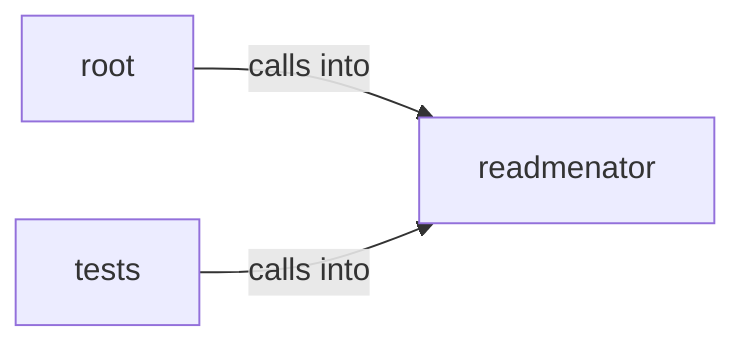

# readmenator: _diagrams

readmenator: _diagrams groups 22 files (py) around readmenatorApplication, __init__, _scan, _scan_with_content, _resolve_imports. Launcher shim that runs the readmenator CLI from a source checkout.

## readmenator (4.1)

readmenator groups 12 files (py) around readmenatorApplication, __init__, _scan, _scan_with_content, _resolve_imports. Command line entry point: argument parsing and subcommand dispatch.

## root (4.2)

root groups 1 files (py). Launcher shim that runs the readmenator CLI from a source checkout.

## tests (4.3)

tests groups 9 files (py) around _node, _fixture, TestCodeboardingSchemaContract, setUp, test_top_level_keys_match_codeboarding. Contract tests for the CodeBoarding-faithful diagram exporter.

**Files**:

- readmenator.py
- readmenator/__main__.py
- readmenator/_app.py
- readmenator/_cursorrules_generator.py
- readmenator/_dead_code.py
- readmenator/_diagrams.py
- readmenator/_gh_wiki.py
- readmenator/_layers.py
- readmenator/_linter.py
- readmenator/_mcp_server.py
- readmenator/_video.py
- readmenator/_watcher.py
- readmenator/_yaralite.py
- tests/test_codeboarding.py
- tests/test_cursorrules.py
- tests/test_dead_code.py
- tests/test_diagrams.py
- tests/test_gh_wiki.py
- tests/test_integration.py
- tests/test_linter.py
- tests/test_mcp_server.py
- tests/test_video.py
