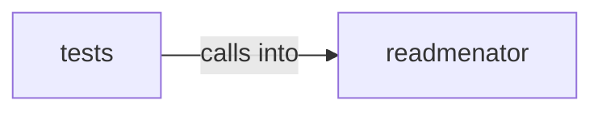

# readmenator: _graphrag

readmenator: _graphrag groups 22 files (py) around EdgeKind, __str__, Morphism, weight, Category. ReadMenator -- Zero-token polyglot codebase knowledge graph generator.

## readmenator (5.1)

readmenator groups 13 files (py) around EdgeKind, __str__, Morphism, weight, Category. ReadMenator -- Zero-token polyglot codebase knowledge graph generator.

## tests (5.2)

tests groups 9 files (py) around TestAgentInjectorInjectBehavior, setUp, tearDown, test_inject_into_agents_md_adds_kb_link, test_inject_into_claude_md_adds_kb_link. Contract tests for AI agent file injection.

**Files**:

- readmenator/__init__.py
- readmenator/_agent_injector.py
- readmenator/_category.py
- readmenator/_codeboarding.py
- readmenator/_concepts.py
- readmenator/_explain.py
- readmenator/_graphrag.py
- readmenator/_ollama.py
- readmenator/_projections.py
- readmenator/_query.py
- readmenator/_rank.py
- readmenator/_readme_injector.py
- readmenator/_symindex.py
- tests/test_agent_injector.py
- tests/test_agent_output.py
- tests/test_concepts.py
- tests/test_graphrag.py
- tests/test_ollama.py
- tests/test_query.py
- tests/test_ranking.py
- tests/test_readme_injector.py
- tests/test_symindex.py
