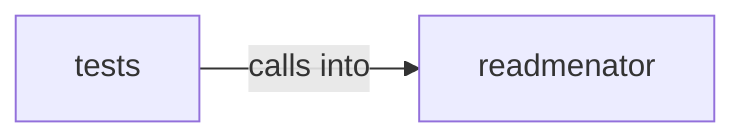

# readmenator: _pipeline

readmenator: _pipeline groups 25 files (py) around ForceAtlas2Settings, _initial_positions, forceatlas2_frames, _snapshot_steps, _fa2_numpy. Corpus analytics aggregations for the readmenator knowledge graph.

## readmenator (3.1)

readmenator groups 17 files (py) around ForceAtlas2Settings, _initial_positions, forceatlas2_frames, _snapshot_steps, _fa2_numpy. Corpus analytics aggregations for the readmenator knowledge graph.

## tests (3.2)

tests groups 8 files (py) around _node, _fixture, _script_json, TestBundleGraphPayloadContract, setUp. Contract tests for the edge bundle explorer (circle and sphere views).

**Files**:

- readmenator/_analytics.py
- readmenator/_bundlegraph.py
- readmenator/_bundlegraph_page.py
- readmenator/_cpg.py
- readmenator/_documentation.py
- readmenator/_embed.py
- readmenator/_exclusions.py
- readmenator/_explorer.py
- readmenator/_exporter.py
- readmenator/_forcegraph.py
- readmenator/_forcegraph_page.py
- readmenator/_graphlayout.py
- readmenator/_pipeline.py
- readmenator/_provenance.py
- readmenator/_scantext.py
- readmenator/_sourceview.py
- readmenator/_uml.py
- tests/test_bundlegraph.py
- tests/test_cpg.py
- tests/test_documentation.py
- tests/test_exporter.py
- tests/test_graphlayout.py
- tests/test_interactive_graph.py
- tests/test_sourceview.py
- tests/test_uml.py
