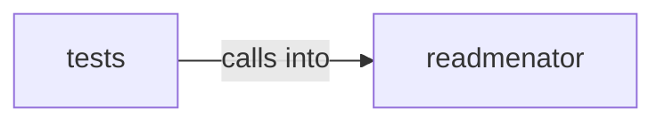

# readmenator/parsers

readmenator/parsers groups 28 files (py) around Symbol, Node, Edge, SecurityFinding, pluralize_symbol_kind. Mermaid graph renderer with intelligent pruning.

## readmenator (2.1)

readmenator groups 24 files (py) around Symbol, Node, Edge, SecurityFinding, pluralize_symbol_kind. Mermaid graph renderer with intelligent pruning.

## tests (2.2)

tests groups 4 files (py) around TestMermaidRendererContract, setUp, test_renders_graph_header, test_renders_module_node, test_renders_symbol_subnodes. Property-based contract tests for all 19 language parsers.

**Files**:

- readmenator/_mermaid.py
- readmenator/_models.py
- readmenator/_sarif.py
- readmenator/parsers/__init__.py
- readmenator/parsers/_assembly.py
- readmenator/parsers/_base.py
- readmenator/parsers/_c.py
- readmenator/parsers/_csharp.py
- readmenator/parsers/_dart.py
- readmenator/parsers/_elixir.py
- readmenator/parsers/_gdscript.py
- readmenator/parsers/_go.py
- readmenator/parsers/_java.py
- readmenator/parsers/_javascript.py
- readmenator/parsers/_kotlin.py
- readmenator/parsers/_lua.py
- readmenator/parsers/_nim.py
- readmenator/parsers/_php.py
- readmenator/parsers/_python.py
- readmenator/parsers/_ruby.py
- readmenator/parsers/_rust.py
- readmenator/parsers/_scala.py
- readmenator/parsers/_shell.py
- readmenator/parsers/_swift.py
- tests/test_mermaid.py
- tests/test_models.py
- tests/test_parsers_property.py
- tests/test_sarif.py
